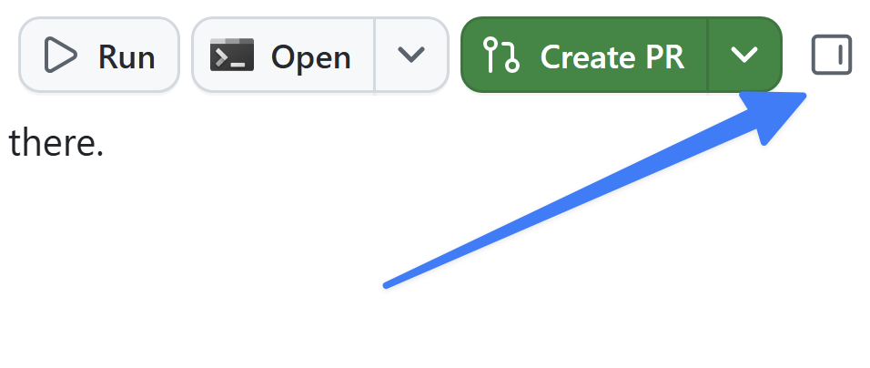

ワークスペースを確認し、クイックチャットを試したので、次は**エージェントセッション**を開始して、プロジェクトに最初の変更を加えます。変更は小さくします。ゲームのデータにはすでに星評価がありますが、ホームページのゲームカードにはまだ表示されていません。エージェントに表示を依頼し、変更をレビューして、最初の pull request としてマージします。

このレッスンでは、次のことを行います。

- エージェントセッションを開始し、セッションの構成を学びます。
- プロジェクトに小規模で対象を絞った変更を加えるようエージェントに依頼します。
- ワークスペースの差分ビューで変更をレビューします。
- アプリをローカルで実行し、ブラウザーで変更を確認します。
- 最初の pull request を作成してマージします。

## シナリオ

Tailspin Toys の各ゲームには星評価を設定でき、ゲーム詳細ページにはすでに表示されています。一方、ホームページのゲームカードには、タイトル、カテゴリー、パブリッシャー、説明だけが表示されています。準備運動として、各カードに既存の評価を表示するようエージェントに依頼します。小規模で自己完結しているため、最初のセッションに最適です。

## セッションの構造

**セッション**とは、独立したワークスペースで実行されるエージェントとの会話です。各セッションには**専用の git worktree とブランチ**が割り当てられます。そのため、一方で機能を追加しながら、もう一方でバグを修正するなど、変更を競合させずに複数のセッションを同時に実行できます。セッションはリポジトリごとにサイドバーにまとめて表示されます。選択するとセッションを切り替えられます。

セッション内には、エージェントとの**会話**、ファイルの調査や編集を行う際の**ツールアクティビティ**、差分を確認できる**変更済みファイル**の一覧が表示されます。

## セッションを開始して変更を依頼する

プロジェクトの調査と機能の実装を始めるため、新しいセッションを開始します。[アプリのセットアップ][prior-lesson]では、GitHub リポジトリからプロジェクトを追加しました。そのリポジトリ用の新しいセッションを作成して変更を依頼します。

1. GitHub Copilot app に戻ります。アプリを閉じている場合は開きます。
2. サイドバーの上部にある **+** を選択してセッションを開始します。
3. リポジトリとして `tailspin-toys` を選択します。
4. プロンプトボックスの下で **new working tree** と **Interactive** モードを選びます。次のプロンプトを使って変更を依頼します。

    ```plaintext
    Show each game's starRating out of 5 in the game cards on the list page. If the rating is null, show "No rating yet". Keep the card layout as it is, add tests, and run the relevant checks.
    ```

5. <kbd>Enter</kbd> を押して、プロンプトを Copilot に送信します。

Copilot app は、まずプロジェクトの独立したコピーである新しい worktree を作成します。次にプロジェクトを調査し、新機能の追加に必要なファイルを探して、コードを作成します。これで Copilot app を使って新しい機能を追加できました。

## 差分をレビューする

AI が生成した変更は、小さなものでもマージ前にレビューします。Copilot app 内で変更を確認しましょう。

1. アプリの右上にある **Toggle review panel** を選択します。開いたパネルで **Changes** を選択し、変更されたファイルとその差分を確認します。

    

2. ゲーム詳細の表示に使われる中心的なファイル `GameCard.astro` にコードが追加されていることを確認します。評価がある場合は表示し、`starRating` が `null` の場合は "No rating yet" を表示する、次のような小さなブロックです。

   ```astro
   {game.starRating !== null ? (
       <span class="text-xs font-medium px-2.5 py-0.5 rounded bg-amber-900/60 text-amber-300" data-testid="game-rating">
           ★ {game.starRating} / 5
       </span>
   ) : (
       <span class="text-xs font-medium text-slate-500" data-testid="game-rating-empty">
           No rating yet
       </span>
   )}
   ```

> [!NOTE]
> Copilot は、すべての生成 AI ツールと同様に決定論的ではなく確率的に動作するため、実際のコードは上記と異なる場合があります。ただし、比較的よく似たものになるはずです。

## 変更を確認する

ブラウザーを開く前に、エージェントによる自動チェックの結果を確認します。数値の `starRating` と `null` の場合の代替表示がテストされていることを確認してください。前提条件が不足していたり、チェックがスキップされていたりする場合は成功ではありません。インストール要求は内容を確認してから承認してください。

コードを読むだけで動くと判断せず、Copilot に Web サイトを起動させ、ブラウザーキャンバスで更新された UI を確認しましょう。

> [!TIP]
> キャンバスは Copilot app 内で利用できるインタラクティブなウィジェットです。後のレッスンではカスタムキャンバスを調べ、自分でも作成します。ここでは組み込みのブラウザーキャンバスを使います。

1. 次のプロンプトを使って、アプリを起動し、ブラウザーキャンバスでページを開くよう Copilot に依頼します。

    ```plaintext
    Start the app and open it in the browser canvas.
    ```

2. しばらくするとアプリが起動し、Copilot app 内にブラウザーウィンドウが開きます。
3. 評価済みのゲームカードに5点満点の値が表示されることを確認します。
4. 確認が終わったら、次のプロンプトで、このセッションで起動した開発サーバーを停止するよう Copilot に依頼します。

    ```plaintext
    Stop the dev server and close the browser canvas.
    ```

## 最初の pull request を作成してマージする

機能を作成できました。次は、新しいコードを既存のコードベースにマージする pull request (PR) を作成します。

1. 右上隅にある **Create PR** を選択します。
2. 求められた場合は **Sign in with your browser** を選択し、画面の指示に従って認証します。
3. PR を作成する前に対応する Issue が必要であるというリポジトリポリシーを Copilot が説明した場合は、その手順に従うよう確認します。
4. Copilot が PR を作成します。
5. チャットのすぐ上にある **PR** バブルを選択し、レビューペインで pull request を開きます。必要に応じてここでレビューします。
6. 準備ができたら **Ready to merge** を選択します。
7. 表示されたダイアログで **Merge pull request** を選択して、pull request をマージします。

## まとめと次のステップ

GitHub Copilot app を使って最初の変更をリリースしました。具体的には、次のことを行いました。

- エージェントセッションを開始し、セッションの構成を学びました。
- ゲームカードに小規模で対象を絞った変更を加えるようエージェントに指示しました。
- ワークスペースの差分ビューで変更をレビューしました。
- アプリをローカルで実行し、ブラウザーで星評価を確認しました。
- PR 1 を作成し、チェックをレビューして、明示的にマージしました。

次は、[フィルター機能の Issue から開始し、Plan モードと Autopilot モードを使用して][next-lesson]、より大きな機能を構築します。

## リソース

- [GitHub Copilot app でのエージェントセッションの操作][agent-sessions]
- [GitHub Copilot app について][about-copilot-app]
- [GitHub Copilot app での Issue と pull request の管理][managing-issues-prs]

[prior-lesson]: ../1-install-copilot-app/#github-copilot-app-をインストールして構成する
[next-lesson]: ../3-agent-modes/
[agent-sessions]: https://docs.github.com/copilot/how-tos/github-copilot-app/agent-sessions
[about-copilot-app]: https://docs.github.com/copilot/concepts/agents/github-copilot-app
[managing-issues-prs]: https://docs.github.com/copilot/how-tos/github-copilot-app/managing-issues-and-pull-requests
